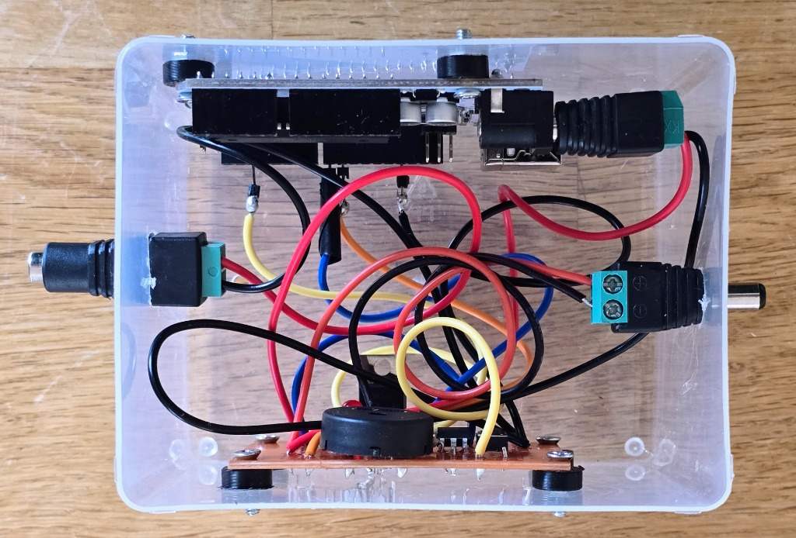
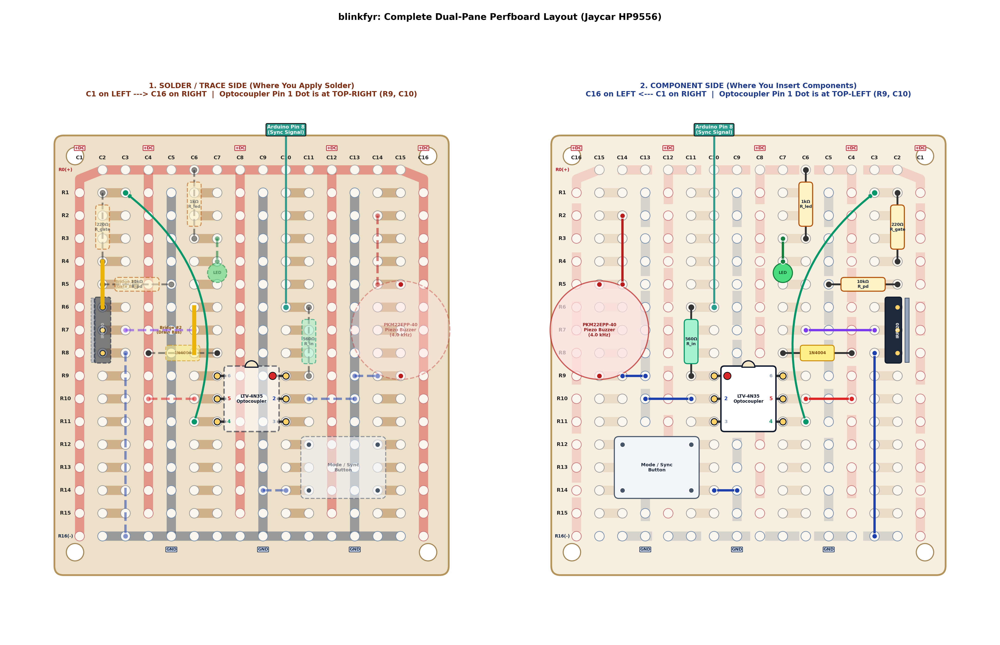

# blinkfyr

A simple DIY Arduino-controlled switch and sync beeper for field gear (cameras, AudioMoths, 12V IR floodlights, and UV bug lights).

---

## What is this?

**blinkfyr** (*Swedish for "blinking beacon / lighthouse"*) is a small, hacky DIY project built around an Arduino Uno, a power MOSFET, an optocoupler, and a piezo beeper. 

It was originally built to synchronize an **AudioMoth** ultrasound recorder with an infrared wildlife camera, but it works as a general-purpose programmable switch for any 9V–15V DC gear you want to automate in the field (like a customizable Christmas light timer for ecological experiments).

---

## Why build it?

1. **Time-syncing different recorders**:
   Audio recorders and trail cameras usually drift out of sync over time, and getting GPS time under heavy tree cover can be tough or power-hungry. By flashing an IR light and beeping a loud chirp at the exact same instant, your cameras (video frame flash) and AudioMoths (audio spectrogram mark) get identical time markers so you can line up files later.
2. **Switching heavy 12V DC loads**:
   Standard Arduino pins only put out 5V and max out at 20–40 mA. To run 12V gear like an IR illuminator (~0.4A) or a high-power UV insect attractor (like a Gunnar Brehm LepiLED, ~1.1A), you need a MOSFET switch.
3. **Why the optocoupler?**:
   Common MOSFETs like the `IRF520` need ~10V on their gate to fully turn on. If you drive them straight from a 5V Arduino pin, the MOSFET only partially opens. That might work for small loads, but when running heavier gear (like the LepiLED), the voltage drops across the MOSFET and starves the load, causing the light's internal driver to rapidly blink/strobe. Adding a cheap `LTV-4N35` optocoupler lets the 5V Arduino pin switch the full 12V supply rail right into the MOSFET gate so it opens all the way with zero flickering.

---

## Example Arduino Sketches

Two ready-to-flash examples are in the [`examples/`](examples/) folder:

### 1. [Camera & AudioMoth Time-Sync Beacon](examples/01_camera_audiomoth_sync/01_camera_audiomoth_sync.ino)
* **What it does**: 
  * Flashes the 12V output and beeps a 1-second pulse once every **30 minutes**.
  * Boots with 3 pulses so you know it's alive and can mark when you started the run.
  * Pressing the button on the board triggers 3 pulses anytime on demand without messing up the 30-minute timer.
* **Use case**: Put it in front of your camera trap and AudioMoth to leave periodic audio/visual sync marks throughout long recording sessions.

### 2. [UV LepiLED Duty-Cycler & Cam Sync](examples/02_uv_lepiled_duty_cycle/02_uv_lepiled_duty_cycle.ino)
* **What it does**: 
  * Alternates between ON and OFF continuously.
  * **Default (3-minute cycle)**: Starts in the ON state with 3 beeps, then runs 3 min ON, 3 min OFF, repeating.
  * **Button toggle (15-second cycle)**: Pressing the button beeps 5 short chirps and switches to 15s ON, 15s OFF. Pressing it again switches back to 3-minute mode.
  * Silent during steady ON and OFF periods (beeps only when switching modes or booting).
* **Use case**: Comparing moth arrival rates under different lighting schedules while using the IR flash to let a night camera track exact on/off timestamps.

### 3. [Manual AudioMoth & Camera Sync Beacon](examples/03_manual_audiomoth_sync/03_manual_audiomoth_sync.ino)
* **What it does**:
  * Completely on-demand manual sync.
  * Boots completely silent and dark (no startup beeps or flashes).
  * No automatic periodic timer.
  * Whenever you press the button, it fires a sequence of **three 0.5-second pulses** (0.5s ON, 0.5s OFF x 3) and returns to silent idle.
* **Use case**: Great when you want to drop sync marks manually at the start and end of an observation run without any periodic beeps disturbing the site.

### 4. [UV Duty-Cycler with Live PC Serial Logging](examples/04_uv_duty_cycle_pc_logger/04_uv_duty_cycle_pc_logger.ino)
* **What it does**:
  * Same 3-minute / 15-second UV duty-cycling behavior as Example 02, but maintains an active USB serial connection to your PC.
  * Emits structured event messages whenever the lights switch ON or OFF, or the mode is toggled.
  * Includes a companion Python script (`logger.py`) that captures the exact local PC wall-clock timestamp (millisecond precision), prints live status to the console, and appends rows to a CSV spreadsheet (`blinkfyr_log.csv`).
  * Also supports interactive keyboard commands from your PC (e.g. sending `'t'` to toggle modes remotely).
* **Use case**: Lab or field-station experiments where a laptop or Raspberry Pi records the exact real-time timestamps of every lighting cycle alongside video and sensor logs.

---

## Circuit Schematic

### Key connections:
* **Arduino Pin 8**: Sends 5V signal through a 560Ω resistor to the optocoupler input (Pins 1 & 2).
* **Optocoupler Pin 5**: Connected to +12V power rail.
* **Optocoupler Pin 4**: Outputs switched 12V through a 220Ω resistor to the `IRF520` MOSFET gate.
* **MOSFET Gate**: Pulled down to GND with a 10kΩ resistor so it stays off when Pin 8 is LOW.
* **MOSFET Drain**: Switches the negative side of the DC output jack.
* **Flyback Diode (1N4004)**: Placed across the DC output (band to +12V) to clamp inductive spikes.
* **Drain LED**: A small indicator LED with a 1kΩ resistor wired between +12V and Drain so you can see when the switch is active.
* **Piezo Sounder (PKM22EPP-40)**: Driven on Arduino Pin 9 with `tone(9, 4000)`. 4.0 kHz is its resonant frequency, so it gives maximum volume with very little current.
* **Pushbutton**: Wired between Arduino Pin 2 and GND using Arduino's built-in `INPUT_PULLUP`.

*Detailed schematic notes can be found in [docs/SCHEMATIC.md](docs/SCHEMATIC.md).*

---

## Perfboard Layout

The prototype was soldered on a standard Jaycar HP9556 experimenter board. Because looking at copper traces on the back while inserting parts on the front gets confusing, here are both sides drawn out side-by-side:

*Step-by-step soldering checklist and multimeter checks are in [docs/BOARD_LAYOUT.md](docs/BOARD_LAYOUT.md).*

---

## Parts List

| Part | Value / Model | Purpose |
| :--- | :--- | :--- |
| **Microcontroller** | Arduino Uno | Runs the timing logic (powered via `VIN` from 9V–15V). |
| **MOSFET** | IRF520 (N-Channel, TO-220) | Switches the ground side of your 12V gear. |
| **Optocoupler** | LTV-4N35 (6-pin DIP) | Uses 5V from Pin 8 to switch 12V onto the MOSFET gate. |
| **Piezo Buzzer** | PKM22EPP-40 (Murata passive) | 4.0 kHz acoustic sync tone. |
| **Flyback Diode** | 1N4004 | Clamps kickback from inductive loads / long wires. |
| **Indicator LED** | Standard 3mm/5mm Green LED | Lights up whenever the MOSFET drain is conducting. |
| **Tactile Button** | Standard 6x6mm momentary button | Manual trigger & mode switching. |
| **Resistor R_in** | 560 Ω (or 1.0 kΩ) | Limits current into optocoupler LED (~7 mA). |
| **Resistor R_gate**| 220 Ω | Gate damping resistor. |
| **Resistor R_pd** | 10 kΩ | Pull-down resistor on gate to keep it off when idle. |
| **Resistor R_led** | 1.0 kΩ | Current limiter for indicator LED on 12V rail. |
| **Power Jacks** | 2.1mm DC barrel jacks | Power input and switched DC output. |
| **Perfboard** | Jaycar HP9556 (or similar) | Prototyping board. |

*Full component inventory and resistor color bands are in [docs/BOM.md](docs/BOM.md).*

---

## Quickstart

1. Flash your chosen sketch using the Arduino IDE:
   * Periodic camera/audio sync: `examples/01_camera_audiomoth_sync/01_camera_audiomoth_sync.ino`
   * Attractor duty cycler: `examples/02_uv_lepiled_duty_cycle/02_uv_lepiled_duty_cycle.ino`
   * Manual on-demand sync: `examples/03_manual_audiomoth_sync/03_manual_audiomoth_sync.ino`
   * Duty cycler + PC timestamp logging: `examples/04_uv_duty_cycle_pc_logger/04_uv_duty_cycle_pc_logger.ino` (paired with `logger.py`)
2. Wire up the board according to the [layout guide](docs/BOARD_LAYOUT.md) and check your connections with a multimeter before plugging into power.
3. Plug in 9V–15V DC power (bench PSU, 12V battery, etc.) into the power input jack.
4. Plug your 12V loads (IR illuminator, UV light, etc.) into the switched DC output jack.

*(Tip: If using a security IR floodlamp that has a built-in daylight sensor dome on the front, stick a piece of black electrical tape over it so it fires in bright rooms during testing!)*

---

## Acknowledgments

Developed with pair-programming assistance from **Google DeepMind's Antigravity (Gemini)** for circuit troubleshooting, schematic generation, and firmware drafting.

---

## License

[MIT License](LICENSE) — Feel free to use, modify, or adapt this for your own projects!
