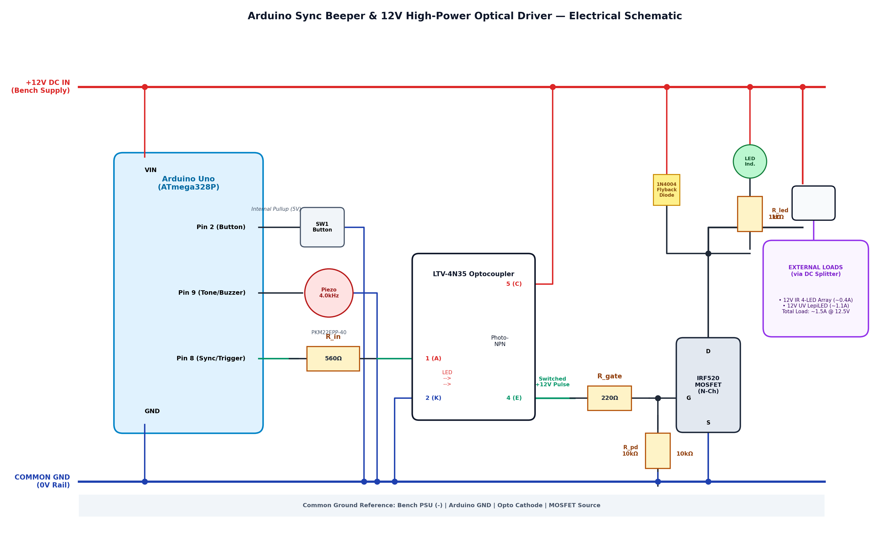
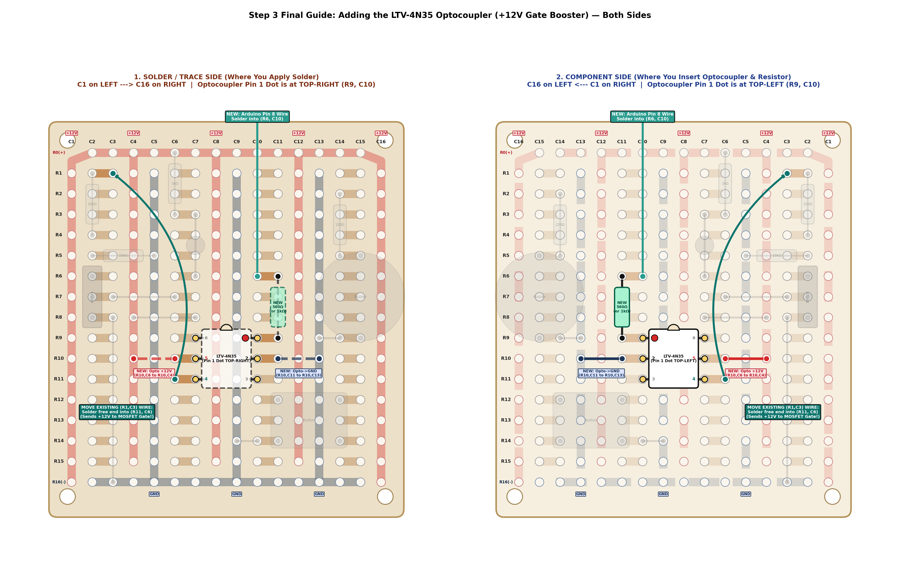

# ArduinoSyncBeeper

> **High-power 12V optical trigger & acoustic synchronization beacon for AudioMoth bioacoustic loggers, night-vision camera setups, and entomological UV light traps.**

[](LICENSE)
[](https://www.arduino.cc/)
[](docs/SCHEMATIC.md)

---

## Overview

In nocturnal wildlife monitoring, syncing acoustic audio data from **Open Acoustic Devices AudioMoth** loggers with optical video footage from **infrared security/wildlife cameras** requires precise, synchronized multi-modal timestamps. In entomological survey work, automated duty-cycling of high-power **UV LepiLEDs** is used to sample insect arrivals over time.

This project provides a robust, field-tested hardware driver board and two interchangeable Arduino firmware sketches that:
1. **Switch High-Power 12V Loads (1.5A+)**: Simultaneously drives an external 12V IR 4-LED illuminator array and a 12V UV LepiLED.
2. **Eliminates MOSFET Pinch-Off & Strobing**: Utilizes an `LTV-4N35` optocoupler level-shifter stage to boost the `IRF520` gate drive to the full $+12\text{V}$ rail ($V_{GS} \approx 11.8\text{V}$), keeping the MOSFET deep in saturation ($R_{DS(on)} \le 0.27\,\Omega$) and preventing switch-mode UV light drivers from brownout oscillation.
3. **Generates Acoustic Sync Beacons**: Drives a `PKM22EPP-40` piezo sounder at its $4.0\text{ kHz}$ resonant frequency with loud, crisp square-wave bursts recorded by AudioMoths.
4. **Flexible Field Control**: Integrated debounced push button and visible drain indicator LED for instant tactile triggering and mode changes in the field.

---

## System Schematic



*Detailed circuit analysis and engineering calculations can be found in [docs/SCHEMATIC.md](docs/SCHEMATIC.md).*

---

## Hardware Architecture

| Subsystem | Components | Function |
| :--- | :--- | :--- |
| **Microcontroller** | Arduino Uno (ATmega328P) | Powers from 12V `VIN`; generates non-blocking interval timers, debounce, and 4.0 kHz tone. |
| **Level Shifter** | `LTV-4N35` Optocoupler + $560\,\Omega$ resistor | Isolates Arduino Pin 8 (5V logic) and outputs switched $+12\text{V}$ to drive the MOSFET gate. |
| **Power Switch** | `IRF520` N-Channel MOSFET + $220\,\Omega$ gate damping + $10\,\text{k}\Omega$ pull-down | Low-side ground return switch for $>1.5\text{A}$ loads; drops $<0.4\text{V}$ $V_{DS}$ in full saturation. |
| **Acoustic Transducer**| Murata `PKM22EPP-40` Piezo Sounder | Driven by Pin 9 at $4.0\text{ kHz}$ resonant frequency for maximum acoustic penetration. |
| **Protection & Diag** | `1N4004` Flyback Diode + Drain Monitor LED ($1\,\text{k}\Omega$) | Clamps inductive switching spikes; visual LED confirms drain conduction. |
| **Tactile Trigger** | 6x6mm Momentary Pushbutton | Connected to Pin 2 with `INPUT_PULLUP` to GND. |

---

## Prototyping Board Layout (Dual-Pane)

The physical circuit is constructed on a **Jaycar HP9556** (COREVA 300-2101) experimenter's perfboard. 

To prevent mirror confusion when soldering, the layout guide provides **both the top Component Side and bottom Solder Side simultaneously**:



*Step-by-step assembly instructions and pre-flight multimeter tests are detailed in [docs/BOARD_LAYOUT.md](docs/BOARD_LAYOUT.md).*

---

## Firmware Options

The repository includes two modular firmware sketches in the [`firmware/`](firmware/) directory:

### 1. [`AudiomothSync.ino`](firmware/AudiomothSync/AudiomothSync.ino) (Periodic Time-Sync Beacon)
Designed for long-term field deployment with AudioMoth loggers and IR cameras:
* **Periodic Sync**: Automatically triggers a single $1.0\text{s}$ sync pulse (12V lights ON + 4.0 kHz beep) every **30 minutes** on a rollover-safe `millis()` timer.
* **Boot & Manual Trigger**: Beeps and flashes **three $1.0\text{s}$ pulses** (1s ON, 1s OFF, 1s ON, 1s OFF, 1s ON) on initial power-up or whenever the manual button is pressed, without disrupting the 30-minute schedule.

### 2. [`AudiomothDutyCycle.ino`](firmware/AudiomothDutyCycle/AudiomothDutyCycle.ino) (Insect Sampling Duty Cycler)
Designed for entomological sampling and light trap comparisons:
* **Duty Cycle**: Alternates continuously between ON and OFF (lights and indicator LED active during ON; silent during steady states).
* **Default Mode (3-Minute Cycle)**: Starts immediately in the **ON** state with **3 long 1-second chirps**, then cycles 3 min ON / 3 min OFF indefinitely.
* **Button Toggle (15-Second Cycle)**: Pressing the tactile button switches to a **15-second cycle** (15s ON / 15s OFF), immediately resetting into the ON state with **5 short confirmation chirps**. Pressing the button again toggles back to 3-minute mode.

---

## Pin Connections Summary

| Arduino Pin | Connection / Component | Notes |
| :---: | :--- | :--- |
| **`VIN`** | $+12\text{V}$ Bench / Battery Rail | Powers Arduino onboard regulator. |
| **`GND`** | Common Ground ($0\text{V}$) Rail | Tied to power supply (-), MOSFET Source, and Opto Cathode. |
| **`Pin 8`** | Optocoupler Pin 1 (via $560\,\Omega$ resistor) | Active HIGH (5V) triggers 12V gate drive. |
| **`Pin 9`** | Piezo Buzzer (+) lead | Generates $4.0\text{ kHz}$ resonant square wave via `tone()`. |
| **`Pin 2`** | Tactile Button to GND | Configured with internal `INPUT_PULLUP`. |

---

## Quickstart

1. Clone this repository:
   ```bash
   git clone https://github.com/rlwilmin-byte/ArduinoSyncBeeper.git
   cd ArduinoSyncBeeper
   ```
2. Open either firmware sketch in the Arduino IDE:
   * **For periodic AudioMoth sync**: Open `firmware/AudiomothSync/AudiomothSync.ino`
   * **For continuous duty cycling**: Open `firmware/AudiomothDutyCycle/AudiomothDutyCycle.ino`
3. Connect your Arduino Uno via USB, select your board and serial port, and click **Upload**.
4. Connect a $12\text{V}$ DC power source (bench PSU or $12\text{V}$ SLA/Li-ion battery) to the board and connect your optical loads via the DC barrel jack.

---

## Documentation Links

* [Bill of Materials & Resistor Bands](docs/BOM.md)
* [Circuit Schematic & Theory of Operation](docs/SCHEMATIC.md)
* [Board Layout & Soldering Checklist](docs/BOARD_LAYOUT.md)

---

## License

This project is licensed under the [MIT License](LICENSE) — see the [LICENSE](LICENSE) file for details.
