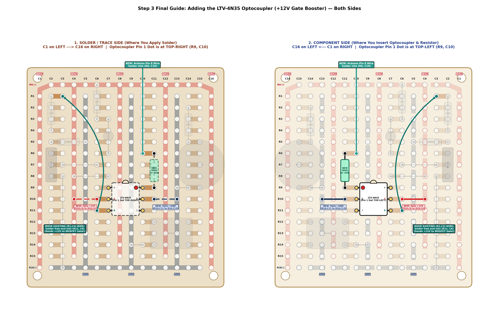

# Soldering & Board Layout Guide

This guide documents the physical construction of the circuit on the **Jaycar HP9556 ("Ultra Mini Experimenters Board")**. 

---

## 1. Dual-Pane Layout Reference

To eliminate confusion between inserting components on the top side and soldering pins on the bottom copper traces, the layout is presented in two mirrored views:

### Understanding the Views:
* **Right Pane (`2. COMPONENT SIDE`)**:
  * View when inserting components from the non-copper top side.
  * Columns run in reverse: **`C16` on the Left $\leftarrow$ `C1` on the Right**.
  * The `IRF520` MOSFET in column `C2` sits on the right side of the board with its **metal heatsink tab facing outward (to the right)** and its plastic face pointing inward.
  * The `LTV-4N35` 6-pin optocoupler has its **orientation notch at the TOP** and **Pin 1 dot at the TOP-LEFT (`Row 9, Col 10`)**.
* **Left Pane (`1. SOLDER / TRACE SIDE`)**:
  * View when looking directly at the copper tracks while soldering.
  * Columns run standard: **`C1` on the Left $\rightarrow$ `C16` on the Right**.
  * Flipped over, **Optocoupler Pin 1 is at the TOP-RIGHT (`Row 9, Col 10`)**.

---

## 2. Component Coordinates & Track Map

The HP9556 board consists of a $16 \text{ columns} \times 17 \text{ rows}$ matrix (`R0..R16`, `C1..C16`):
* **Top Rail `R0` (`C2..C15`)**: Common $+12\text{V}$ rail.
* **Bottom Rail `R16` (`C2..C15`)**: Common $\text{GND}$ ($0\text{V}$) rail.
* **Vertical $+12\text{V}$ Rails**: `C1`, `C4`, `C8`, `C12`, `C16`.
* **Vertical $\text{GND}$ Rails**: `C5`, `C9`, `C13`.
* **Horizontal 2-Pin Strips (`o-o`)**: `C2-C3`, `C6-C7`, `C10-C11`, `C14-C15` across rows `R1..R15`.

---

## 3. Step-by-Step Soldering Sequence

### Step 1: Base Components
1. **MOSFET (`IRF520`)**: Insert into `C2` (`Pin 1: R6 (Gate)`, `Pin 2: R7 (Drain)`, `Pin 3: R8 (Source)`).
2. **Underside Solder Bridge #1**: On the solder side, bridge copper track `R4, C2` across to `R6, C2` (Gate bus).
3. **Underside Solder Bridge #2**: On the solder side, bridge copper track `R8, C6` across to `R6, C6` (Drain bus).
4. **Gate Resistors**:
   * $R_{\text{gate}} = 220\,\Omega$: Insert from `(R1, C2)` to `(R4, C2)` (spans 2 empty holes).
   * $R_{\text{pd}} = 10\,\text{k}\Omega$: Insert from `(R5, C2)` to `(R5, C5)` (GND rail).
5. **Drain Monitor & Flyback Protection**:
   * Flyback Diode (`1N4004`): From `(R8, C4)` (+12V) to `(R8, C7)` (Drain bus). Cathode band faces `C4` (+12V).
   * Indicator LED: Anode into `(R4, C7)`, Cathode into `(R5, C7)`.
   * LED Resistor ($1\,\text{k}\Omega$): From `(R0, C6)` (+12V) to `(R3, C6)`.
   * Jumper: From `(R3, C7)` to `(R6, C7)`.
6. **Buzzer & Button**:
   * Piezo Buzzer (`PKM22EPP-40`): Legs into `(R5, C15)` and `(R9, C15)`. Jumper `(R9, C14)` to `(R9, C13)` (GND).
   * Button (`SW1`): Insert across `C11` and `C14` on rows `R12..R14`. Jumper `(R14, C10)` to `(R14, C9)` (GND).

---

### Step 2: Optocoupler Addition (Level Shifter)
1. **Insert `LTV-4N35`**:
   * Straddle across `Col 10` and `Col 7` on rows `R9, R10, R11`.
   * Component Side: **Notch at TOP**, **Pin 1 dot at TOP-LEFT (`R9, C10`)**.
   * Solder all 6 pins on the solder side.
2. **Opto Input Resistor ($560\,\Omega$ or $1.00\,\text{k}\Omega$)**:
   * Insert from `(R6, C11)` to `(R9, C11)`.
   * *Track at R9 automatically connects this resistor to Opto Pin 1*.
3. **Jumper #1 (Opto Cathode to GND)**:
   * Insulated link from `(R10, C11)` (Opto Pin 2) to `(R10, C13)` (GND Rail).
4. **Jumper #2 (Opto Collector to +12V)**:
   * Insulated link from `(R10, C6)` (Opto Pin 5) to `(R10, C4)` (+12V Rail).
5. **Gate Trigger Link**:
   * Move the flying wire from `(R1, C3)` and solder its other end into `(R11, C6)`.
   * *Connects Opto Pin 4 Emitter (+12V switched output) into the MOSFET Gate circuit*.
6. **Arduino Pin 8 Input Wire**:
   * Solder a new wire into `(R6, C10)` and terminate with a stiff pin to enter Arduino **Pin 8**.

---

## 4. Pre-Flight Multimeter Verification

Before applying $12\text{V}$ power, measure the following on your multimeter:

| Measurement Points | Expected Reading | Interpretation |
| :--- | :---: | :--- |
| **MOSFET Gate `(R1, C3)` to GND** | $\approx 10.0\,\text{k}\Omega$ | Verifies pull-down resistor holds gate firmly at 0V when unpowered. |
| **+12V Rail `(R10, C4)` to GND** | Open / $>100\,\text{k}\Omega$ | Confirms no solder bridges or dead shorts across main power rails. |
| **Arduino Pin 8 Wire `(R6, C10)` to GND** (Diode Mode) | $\approx 1.1\text{V} - 1.3\text{V}$ | Verifies optocoupler internal IR LED polarity and continuity. (Reverse should read OL). |
| **Opto Collector `(R10, C6)` to Emitter `(R11, C6)`** | Open / OL | Confirms phototransistor is normally open when unpowered. |
