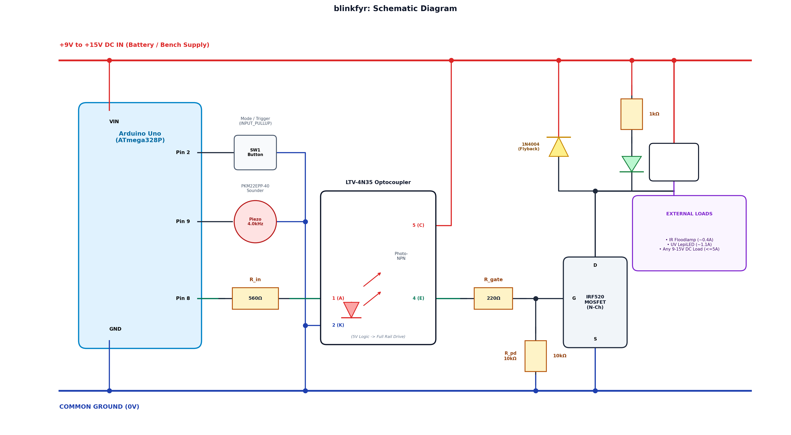

# blinkfyr: Circuit Notes & Schematic

A quick reference explaining the circuit and why certain parts were chosen.

---

## Schematic

---

## How It Works

### 1. Power Input (9V to 15V DC)
The board runs on anything from **9V to 15V DC**:
* **12V batteries** (lead-acid, SLA, 3S/4S lithium packs).
* **Bench power supplies** or 12V DC wall adapters.

The power input feeds both the switched 12V output rail and the Arduino's `VIN` pin (which steps it down to 5V for the chip).

---

### 2. The MOSFET Switch & Why We Use an Optocoupler

We're using an **`IRF520` N-channel MOSFET** to switch the negative (ground) side of the output jack.

#### The 5V problem:
Standard power MOSFETs like the `IRF520` need around **10V** on their gate to open fully. 
* If you drive the gate directly from an Arduino pin (5V), the MOSFET only turns partway on.
* For a light load (like a 400mA IR floodlight), it might work fine.
* But when you plug in a heavier load like a UV LepiLED (~1.1A with higher startup inrush), the partially open MOSFET drops 4–5 volts across itself. 
* That voltage drop starves the light's internal power supply, making it flicker or strobe rapidly.

#### The optocoupler fix:
We added a cheap **`LTV-4N35` 6-pin optocoupler** to act as a 12V gate driver:
1. When Arduino **Pin 8** goes HIGH (5V), it lights the tiny infrared LED inside the optocoupler through a `560Ω` resistor (~7 mA).
2. That turns on the phototransistor inside the chip, which connects the **+12V rail directly to the MOSFET gate**.
3. Now the gate gets ~11.8V, so the MOSFET turns completely ON. Channel resistance drops to less than $0.27\Omega$, voltage drop across the MOSFET drops to under 0.4V, and the lights run rock solid without flickering.
4. When Pin 8 goes LOW, the optocoupler turns off, and a `10kΩ` pull-down resistor drains the gate to ground to turn the MOSFET off cleanly.

---

### 3. Piezo Buzzer (PKM22EPP-40)

* We use a passive piezo disc driven by Arduino **Pin 9**.
* The sketch uses `tone(9, 4000)` to generate a 4.0 kHz square wave.
* 4.0 kHz is the resonant frequency of this piezo, which means it vibrates at its natural sweet spot—giving you the loudest beep while drawing less than 5 mA from the Arduino.
* That sharp 4.0 kHz beep shows up clearly on AudioMoth spectrograms for easy time-aligning.

---

### 4. Protection & Status

* **Flyback Diode (1N4004)**: Connected across the 12V output jack (cathode stripe to +12V). When the MOSFET suddenly shuts off, any inductance in long cables or driver coils kicks back a voltage spike; the diode safely absorbs this so the MOSFET isn't damaged.
* **Drain LED**: A simple green LED with a `1kΩ` resistor wired between +12V and Drain. It lights up whenever the MOSFET is actively conducting, giving you visual feedback that the switch is on.
* **Button (Pin 2)**: Wired between Pin 2 and GND. The sketch enables Arduino's internal pull-up resistor (`INPUT_PULLUP`), so no external resistor is needed.
